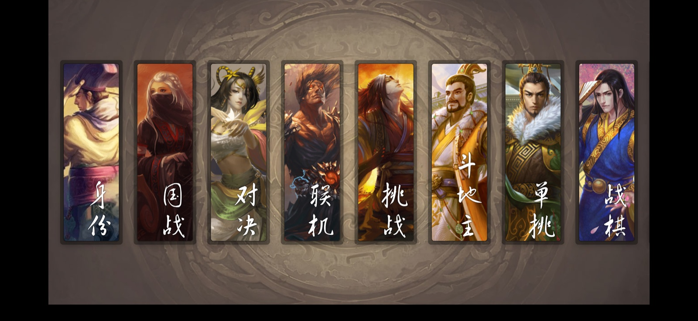
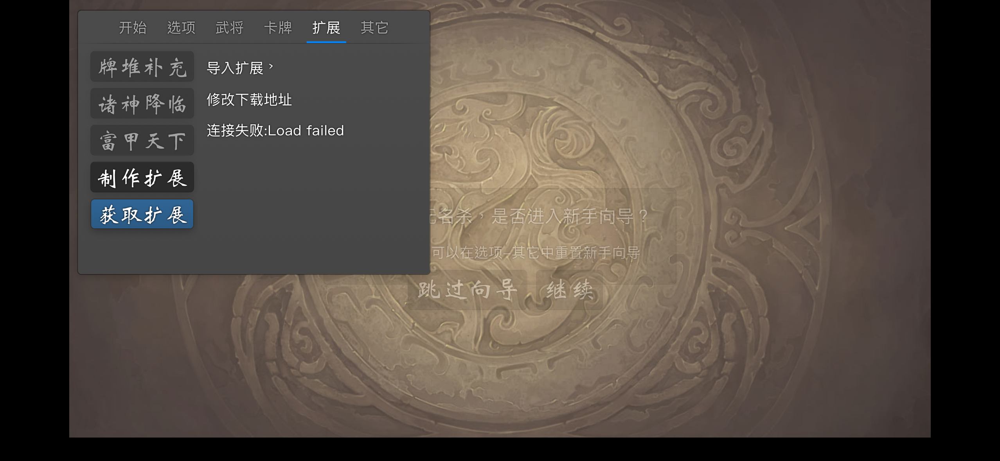

# 无名杀 iOS 版

在 iPhone / iPad 上运行《无名杀》的原生客户端。产物是一个**未签名 IPA**，玩家用自己的 Apple ID（或自备证书）签名后安装，不需要上架 App Store，也不需要 Apple 开发者账号。



```
┌──────────────────────────────────────────────┐
│  Noname.app                                  │
│                                              │
│  WKWebView  ──加载──►  http://127.0.0.1:19530│
│      │                        │              │
│      │                  本地 HTTP 服务        │
│      │                        │              │
│      │              ┌─────────┴─────────┐    │
│      │              │ 只读层：Bundle/web │    │
│      │              │ 可写层：Documents/ │    │
│      │              │        Noname      │    │
│      │              └───────────────────┘    │
└──────────────────────────────────────────────┘
```

## 1. 设计思路

无名杀本体是一个纯 Web 应用（`apps/core`），安卓客户端（`apps/mobile`）用 Capacitor 套了一层 WebView，
并解决了两个平台问题：**资源怎么加载**、**存档/扩展怎么写**。

iOS 版用同样的思路，但实现更轻：**不引入 Capacitor / CocoaPods / 任何第三方依赖**，只用系统自带的
`WKWebView` + `Network.framework`。

| 能力 | 安卓版 | iOS 版 |
| --- | --- | --- |
| 承载 | Capacitor + Android WebView | 原生 `WKWebView` |
| 只读资源 | APK `assets/public` | App 包内 `Bundle/web` |
| 可写目录 | 用户选择的 SAF 目录 | 沙盒 `Documents/Noname`（「文件」App 可见） |
| 资源请求 | `WebViewAssetLoader` + SAF 覆盖层 | 内置 HTTP 服务 + 覆盖层 |
| JS 文件 API | Capacitor 插件 `SafFs` | 复用 `@noname/fs` 的 HTTP 接口 |
| 启动脚本 | `apps/mobile/src/preload.ts` | `apps/ios/web-preload.js` |

### 为什么用本地 HTTP 服务，而不是 `file://` 或自定义 scheme？

1. `file://` 在 WKWebView 下 `fetch` 受同源策略限制、ES Module 加载会失败，而游戏明确要求 `indexedDB`。
2. `capacitor://` 这类自定义 scheme 不支持 service worker，`<audio>` 的 Range 请求行为也不一致，
   而游戏有 640MB 音频、需要拖动进度条。
3. `http://127.0.0.1:端口` 是一个**正常的 Web 源**：`localStorage`、`IndexedDB`、`fetch`、`<audio>`、
   ES Module、Import Map 全部按标准工作，和 PC 上跑 `noname-server` 完全一致。

端口**必须固定**（19530 起）。origin 里包含端口，端口一变，`localStorage`/`IndexedDB` 里的配置和存档
就全部"消失"了。

### 文件系统：只读层 + 可写层

* 读：先找 `Documents/Noname/<路径>`，找不到再找 `Bundle/web/<路径>`；
* 写：只写 `Documents/Noname/`；
* 列目录：两层合并，可写层优先。

这正是安卓版 SAF 覆盖层的语义。带来的好处：

* 玩家导入的扩展、导出的存档、下载的资源都落在 `Documents/Noname`，卸载重装前可以用「文件」App 备份；
* 在 `Documents/Noname` 里放一个和内置资源同名的文件，就能替换内置资源（删掉即恢复）；
* 游戏本体不用整包复制到沙盒，省掉 1.3GB 的首次启动拷贝。

## 2. 目录结构

```
apps/ios/
├── Noname/                     # 原生代码
│   ├── AppDelegate.swift         # 进程级生命周期
│   ├── SceneDelegate.swift       # UIScene 生命周期（iOS 27 必需）
│   ├── GameViewController.swift  # WKWebView、弹窗、分享、下载
│   ├── LocalServer.swift         # 本地 HTTP 服务 + 文件系统接口
│   ├── HTTPTypes.swift           # HTTP 解析/序列化
│   ├── Info.plist                # 含 UIApplicationSceneManifest
│   └── Assets.xcassets/          # AppIcon / 启动背景色
├── web/                        # 构建时从 dist/ 同步（.gitignore）
├── web-preload.js              # iOS 专用 preload（补 game.download / game.export）
├── project.yml                 # XcodeGen 工程描述
├── Noname.xcodeproj            # 已生成的工程，可直接用 Xcode 打开
└── scripts/buildIos.ts         # 一键构建 + 打包 IPA
```

## 3. 构建

### 环境

* macOS + Xcode 16 及以上（需要 iOS 16.4+ SDK；Xcode 27 / iOS 27 SDK 已适配 UIScene 要求）
* Node.js `^20.19.0 || >=22.12.0`、pnpm `>= 9`
* 可选：[XcodeGen](https://github.com/yonaskolb/XcodeGen)（只有改了 `project.yml` 才需要）

### 命令

```bash
pnpm install
pnpm build                      # 生成 dist/（约 1.3GB，含图片和音频）
pnpm -F @noname/ios build:ios   # 编译 + 打包
```

产物：

```
apps/ios/build/ipa/noname-unsigned.ipa
```

可用参数：

| 参数 | 说明 |
| --- | --- |
| `--skip-web-build` | 复用已有 `dist/`，跳过 `pnpm build` |
| `--no-audio` | 打包时剔除 `audio/`，IPA 约减半（无 BGM/音效） |
| `--core` | 再剔除 `image/`，IPA 最小，但卡牌/立绘会缺图 |
| `--debug` | 构建 Debug 配置（含调试接口） |
| `--prune` | 构建完删除 `dist/`、`Payload/`，CI 省磁盘用 |
| `--no-transcode` | 跳过「低码率 mp3 → AAC」转码（调试用） |

### iOS 27 / Xcode 27：必须使用 UIScene 生命周期

用 Xcode 27（iOS 27 SDK）构建的 App 如果没有声明 `UIApplicationSceneManifest`，在 iOS 27 上会**一启动就被系统终止**：

```
Application failed to launch: UIScene life cycle is required for apps built with this SDK.
EXC_BREAKPOINT (SIGTRAP) _UIApplicationEvaluateRuntimeIssueForNoSceneLifecycleAdoption
```

iOS 26 对旧生命周期只是打印警告，所以只跑 iOS 26 模拟器时完全看不出来——这正是「签完名、一打开就闪退」的根因。

本工程现在把窗口放在 `SceneDelegate` 里创建，`Info.plist` 声明了 `UIApplicationSceneManifest`，
并且构建脚本会在打包前强制校验：缺少场景配置会直接构建失败，不会再产出会闪退的 IPA。

完整流程等价于：

```bash
# 1. 同步资源
rsync -a --delete dist/ apps/ios/web/
cp apps/ios/web-preload.js apps/ios/web/preload.js

# 2. 编译（不签名）
xcodebuild -project apps/ios/Noname.xcodeproj -scheme Noname \
  -configuration Release -sdk iphoneos -derivedDataPath apps/ios/build/DerivedData \
  CODE_SIGNING_ALLOWED=NO CODE_SIGNING_REQUIRED=NO build

# 3. 打包
mkdir -p Payload && cp -R .../Noname.app Payload/
ditto -c -k --sequesterRsrc --keepParent Payload noname-unsigned.ipa
```

> 用 Xcode 直接跑也可以：打开 `apps/ios/Noname.xcodeproj`，在 *Signing & Capabilities* 里选自己的 Team，
> 连上手机 Run 即可（免费 Apple ID 同样受 7 天限制）。

## 4. 官方更新后怎么升级

官方仓库（`libnoname/noname`）更新后，iOS 端需要把新的 `dist/` 重新打进 App 并重签。有三条路：

| 方式 | 要 Mac | 要重签 | 适用 |
| --- | --- | --- | --- |
| **GitHub Actions 自动构建（推荐）** | 否 | 是 | 日常跟进官方更新 |
| 本地一键重建 | 是 | 是 | 改了 Swift 原生代码 |
| 热更新包（只换 web 层） | 一次 | 否 | 小版本、不想重签 |

### 4.1 GitHub Actions 自动构建

仓库里的 [`.github/workflows/ios.yml`](../../.github/workflows/ios.yml) 会：

1. 每天 **北京时间 02:30** 拉取一次官方**最新正式版标签**（latest，不是 `main`）；
2. 用官方最新代码覆盖工作区，只保留本仓库里的 `apps/ios/`（iOS 客户端壳）；
3. 构建 Web 产物 → 编译 App → 打包未签名 IPA；
4. 发布到 **Releases**，标签形如 `ios-<官方提交>-<iOS客户端提交>-<变体>`；
5. 如果这个组合已经构建过，直接跳过，不浪费构建时间。

#### 一次性配置

有两种放法，任选其一：

* **Fork 官方仓库**（推荐）：保留完整历史，以后想给官方提 PR 也方便；
* **新建一个空仓库**：只放 `apps/ios/` 和 `.github/workflows/ios.yml`，仓库只有几 MB。
  workflow 只依赖这两样东西，其它文件都会在构建时从官方仓库拉取。

下面以 Fork 为例：

1. 在 GitHub 上 **Fork** `https://github.com/libnoname/noname`（服务端复制，不需要把 1.1GB 历史传上去）；
2. 本地把 iOS 客户端提交并推到自己的 fork：

   ```bash
   git remote add myfork https://github.com/<你的账号>/noname.git
   git checkout -b ios
   git add apps/ios .github/workflows/ios.yml package.json README.md
   git commit -m "feat(ios): native iOS client"
   git push myfork ios:main
   ```

   > `apps/ios/web/`（1.3GB）和 `apps/ios/build/` 已在 `.gitignore` 里，不会提交；
   > 推到 fork 时只会新增 `apps/ios` 的源码（几 MB），不会重传整个仓库。

3. 打开 fork 的 **Settings → Actions → General → Workflow permissions**，选 **Read and write permissions**
   （发布 Release 需要）；在 **Actions** 页启用 workflows。
4. 想立刻验证：**Actions → Build iOS (unsigned IPA) → Run workflow**。

如果选的是空仓库，初始化命令类似：

```bash
mkdir noname-ios && cd noname-ios && git init -b main
rsync -a --exclude web --exclude build --exclude node_modules \
  /path/to/noname/apps/ios ./
mkdir -p .github/workflows
cp /path/to/noname/.github/workflows/ios.yml .github/workflows/
git add -A && git commit -m "feat: noname iOS wrapper"
git remote add origin https://github.com/<你的账号>/noname-ios.git
git push -u origin main
```

#### 之后怎么用

* 官方更新后什么都不用做，第二天早上 Release 里就会有新包；
* 也可以在 Actions 页手动触发，支持：
  * `variant`：`full` / `no-audio` / `core`（体积从小到大）；
  * `upstream_ref`：默认 `latest`（最新正式版标签）；也可以固定成某个 tag（例如 `v1.11.6`），
    或填 `main` 构建测试版——注意测试版版本号通常比正式版大，**联机会被拒绝**；
  * `force`：这个组合构建过也强制重建。
* 下载 Release 里的 `noname-unsigned-<变体>.ipa`，用 Sideloadly / AltStore / 轻松签 重签安装即可。

#### 版本核对

游戏内 **选项 → 其它 → 更新** 会显示 `游戏版本：1.11.7 (release @ <官方提交>)`，
这个 commit 就是构建时嵌入的官方代码版本，可以和 Release 标签对上。

#### 注意事项

* **公开 fork 免费**；私有 fork 会消耗 macOS 构建分钟数（约为 Linux 的 10 倍）和 Release 存储；
* 首次构建约 **30–40 分钟**，IPA 约 1.1GB；
* 上游如果改了项目结构导致构建失败，看 Actions 日志定位，本地修好 `apps/ios` 再推；
* Release 里的文件长期保存（不像 Actions artifact 只有 7 天）；
* 每个 IPA 约 1.1GB，workflow 会自动只保留最近 3 个 Release（`gh release delete`），
  避免仓库存储无限增长；
* macOS runner 只有 14GB 磁盘，所以 CI 构建时用了 `--prune`（构建完删除 `dist/`、`Payload/`），
  并在拉完代码后删掉 `.git` 历史。

### 4.2 本地一键重建（改了原生代码时用）

```bash
git fetch origin main && git merge --ff-only origin/main   # 或手动同步官方代码
pnpm install
pnpm build                                                  # 生成 dist/
pnpm -F @noname/ios build:ios --skip-web-build              # 编译 + 打包
# → apps/ios/build/ipa/noname-unsigned.ipa
```

### 4.3 热更新包（不重签，只换 web 层）

游戏逻辑几乎都在 web 层。`Documents/Noname` 是可写覆盖层，把新版本变化的文件放进去、重启游戏即可生效，
证书和签名都不用动。适合官方小版本更新；Swift 原生壳有改动时仍要重新签名。

> 注意：覆盖层里的文件会一直遮蔽内置资源，确认稳定后建议在下次重签时清掉，避免占用双份空间。
> 官方目前把游戏内的「在线更新」入口禁用了，所以热更新需要自己把文件放进沙盒。

## 5. 安装：自己签名

IPA 是**未签名**的，需要重新签名才能装进手机。下面几种方式按推荐顺序排列。

### 4.1 Sideloadly（Windows / macOS，最适合新手）

1. 电脑安装 [Sideloadly](https://sideloadly.io/) 和 iTunes（Windows 需要）；
2. 用数据线连接 iPhone，信任电脑；
3. 把 `noname-unsigned.ipa` 拖进 Sideloadly，填写自己的 Apple ID；
4. 点 Start，输入 Apple ID 密码（如开启双重认证，需要用专用密码）；
5. 首次安装后，到 **设置 → 通用 → VPN 与设备管理** 里信任你的开发者证书。

### 4.2 AltStore / SideStore（可以在手机上自动续签）

* [AltStore](https://altstore.io/)：电脑装 AltServer，手机同 Wi-Fi 下可自动 7 天续签；
* [SideStore](https://sidestore.io/)：无需电脑常驻，用 WireGuard 在本机续签。

两者都支持直接安装未签名 IPA（会自动用你的 Apple ID 重签）。

### 4.3 TrollStore（永久签名，最省事）

TrollStore 利用系统漏洞做**永久签名**，装完不会掉签，也没有 7 天限制。
仅支持特定系统版本（如 iOS 14.0–16.6.1、17.0 等，具体以 TrollStore 官方说明为准）。
把 IPA 用 TrollStore 打开即可安装。

### 4.4 自有开发者证书 / 企业证书

有付费开发者账号（$99/年）时，可以用 Xcode 的 *Distribute App → Ad Hoc* 导出，
或用 `codesign` + `ldid` 手动签名，再配合自己的描述文件安装。付费证书有效期 1 年。

### 4.5 国内签名工具（轻松签 / ESign / 爱思助手等）

这类工具可以导入 IPA 后用**共享企业证书**签名，安装方便，但共享证书随时可能被苹果封禁（掉签），
掉签后 App 会打不开，**数据还在**，重新签名安装即可，不要先删除 App。

### 4.6 签名前后的注意事项

| 事项 | 说明 |
| --- | --- |
| 免费 Apple ID 限制 | 证书 7 天有效、最多同时 3 个自签 App、需要每 7 天重签 |
| Bundle ID | 若提示 App ID 冲突，把 `PRODUCT_BUNDLE_IDENTIFIER` 改成自己的（如 `com.yourname.noname`），签名工具通常也会自动加后缀 |
| 换 Bundle ID 的副作用 | 存档目录跟着变，旧存档不会自动迁移（可先在游戏内导出） |
| 体积 | IPA 约 1.2GB，安装时约需 2.5GB 空闲空间，首次安装偏慢 |
| 掉签 | 重新签名安装即可；**不要先删除 App**，否则沙盒数据一起没了 |
| 存档备份 | 「文件」App → 我的 iPhone → 无名杀，整个目录可以直接拷贝出来 |

## 6. 装扩展 / 换资源（和安卓一样可以导入文件）

无名杀本体支持「往游戏目录里放文件」来加功能：扩展（武将、卡牌、技能、模式）、自定义图片语音、
懒人包配置等。安卓端靠 SAF 目录 + Capacitor 的文件插件实现，iOS 端靠 `Documents/Noname` 覆盖层 +
同一套 `@noname/fs` 接口实现，**玩法完全一致**。

### 5.1 游戏内导入扩展（推荐，不需要电脑）



1. 把扩展的 `.zip` 包先存到「文件」App（微信/QQ 里选「用其他应用打开」→ 存储到「文件」）；
2. 打开游戏 → **选项 → 扩展 → 获取扩展** → 展开 **导入扩展**；
3. 点选择框，会弹出系统文件选择器（「最近项目 / 共享 / 浏览」），选中 zip → **确定**；
4. 提示「导入成功，3 秒后将重启」→ 重启后到 **扩展** 页把新扩展打开。

导入的扩展会解压到 `Documents/Noname/extension/<扩展名>/`，重启后从可写层加载。

> 文件选择器走的是 `WKWebView` 原生的 `<input type="file">`，iOS 16.4+ 支持良好；
> 选完之后文件只读一次，不会留在 App 里，扩展本体落在上面那个目录。

**zip 包结构要注意**：`extension.js`（或 `info.json`）必须在压缩包的**根目录**，
不能外面再套一层文件夹——否则会解压成 `extension/<扩展名>/<文件夹>/extension.js`，游戏找不到入口。
在电脑上压缩时，请进入扩展文件夹后全选文件再压缩。

> 「获取扩展」页的在线列表需要能访问 GitHub；连不上时会显示「连接失败: Load failed」，
> 这不影响下面的「导入扩展」。

### 5.2 从「文件」App 直接放进去

「文件」App → **我的 iPhone → 无名杀 → Noname**，这里的目录结构和游戏根目录一致：

```
Documents/Noname/
├── extension/            # 扩展，一个扩展一个文件夹
│   └── 我的扩展/
│       ├── extension.js  # 或 info.json + main/content.js 的标准工程结构
│       └── image/...
├── image/                # 放同名文件即可覆盖内置图片
├── audio/                # 覆盖内置语音
├── export/               # 游戏内导出的文件（存档、录像、设置）
└── noname.config.txt     # 懒人包配置（启动时读一次，读完自动删除）
```

放好后有两种生效方式：

* **手动**：重启游戏 → 选项 → 扩展 → 找到新扩展 → 打开；
* **自动**：选项 → 通用 → 打开 **自动导入扩展**，之后每次启动都会扫描 `extension/` 下新增的扩展
  （自动导入的扩展默认是关闭的，仍需手动打开）。

### 5.3 懒人包 / 配置迁移

游戏支持把一份 `noname.config.txt` 放进游戏根目录，启动时自动应用（导入完会自动删除）。
在 iOS 上把它放到 `Documents/Noname/noname.config.txt` 即可，格式与 PC 端一致
（`lib.init.encode(JSON.stringify({config, data}))`，即 base64 过的 JSON）。

### 5.4 导出：存档、录像、设置

* 选项 → 其它 → **导出游戏设置** / 导出录像：文件会写到 `Documents/Noname/export/`，
  并自动弹出系统分享面板，可以直接「存储到文件」或发微信；
* 导出的文件名会自动过滤非法字符，中文名正常。

### 5.5 已知差异

* **`.ts` 扩展无法即时编译**：依赖 service worker 的 JIT 转译在 `127.0.0.1` 上不可用，
  只有编译好的 `.js` 扩展能直接跑（绝大多数发布版扩展都是 `.js`，不受影响）。
* **扩展包体积**：单个 `writeFile` 请求上限 512MB（`HTTPRequest.parse`），足够放任何扩展。
* **删不掉内置资源**：`removeFile` / `removeDir` 只作用于可写层，内置资源是只读的
  （覆盖用同名文件，恢复就删掉可写层那个文件）。

## 7. 定制

| 想改什么 | 改哪里 |
| --- | --- |
| 显示名称 | `Noname/Info.plist` 的 `CFBundleDisplayName` |
| Bundle ID / 版本号 | `project.yml`（改完执行 `xcodegen generate`）或 Xcode 工程设置 |
| 图标 | 替换 `Noname/Assets.xcassets/AppIcon.appiconset/icon-1024.png`（1024×1024，不能带透明通道） |
| 横竖屏 | `Info.plist` 的 `UISupportedInterfaceOrientations` + `GameViewController.supportedInterfaceOrientations` |
| 是否避让安全区 | `GameViewController.setupWebView()` 里的约束（改成 `view` 就是全屏铺满） |
| 端口 | `LocalServer.start(preferredPorts:)` |

## 8. 已知限制

* **没有 service worker**：WKWebView 只对 app-bound domain 开放 Service Worker，`http://127.0.0.1`
  用不了。上游构建会往 `index.html` 注入一段 JIT 引导脚本，缺 service worker 时会弹窗并刷新两次，
  构建脚本会把它移除。影响：**`.ts` 写的扩展无法即时编译**，`.js` 扩展不受影响。
* **不能后台运行**：切到后台会被系统挂起，回到前台继续（和安卓的 pause/resume 行为接近）。
* **iOS 27 起必须使用 UIScene 生命周期**：本工程已适配（`SceneDelegate.swift` + `UIApplicationSceneManifest`），
  用 Xcode 27 构建也不会闪退。
* **音量与音频播放补丁**：iOS 的 WebKit 有两个坑——它会忽略 `HTMLMediaElement.volume`
  （读回来是 1），而且 `createMediaElementSource` 接管后的元素开头 0.3~0.6 秒会被吞掉
  （「过河拆桥」只听见「拆桥」）。`web-preload.js` 里因此分成两条路径：
  * 台词、技能音等**短音频**（≤60s）：`decodeAudioData` 解码成 AudioBuffer，
    原生元素静音播放、只负责 `play`/`ended` 事件，真正的声音由 `AudioBufferSourceNode`
    从头播放——没有开头损失，音量也精确；
  * **BGM / 视频**：仍走 `MediaElementSource` + `GainNode`，换曲时开头会损失一点点，可以接受。

  WebKit 的 `decodeAudioData` 对一部分 MP3 会直接失败（已知集中在 MPEG-2 Layer III
  @32kbps，例如 `audio/card/male/guohe.mp3`）。构建脚本会在打包前用 macOS 自带的
  `afconvert` 把**所有非 BGM 的 mp3**（包括 `extension/` 下扩展自带的音频）转成 AAC——
  44.1k/48k 用 96kbps，低采样率用 64kbps，保证解码全部成功。**文件名仍然是 `.mp3`**，
  本地服务按文件头返回 `audio/mp4`。素材里还有少量「扩展名 .mp3、内容其实是 WAV / Ogg / ADTS」
  的文件，也会先按真实容器换临时扩展名再转（Ogg 文件 WebKit 本来就解不了，转完才可用）。

  另外，iOS 同时播放多个 media element 时会把旧的暂停；buffer 播放不依赖原生播放状态，
  不会因此被截断（只有 `ended` / 换源才会停）。游戏里 `audio.autoplay = true` 的元素
  不会经过 `play()`，preload 在 `play` 事件里同样会把它们切换到 buffer 播放，
  否则会以原生方式播出去（音量不受控，还可能被 iOS 的并发限制掐掉）。

  **时长未知时不接 MediaElementSource**：`play` 事件可能在元数据加载前就触发，
  这时如果直接把元素接进音频图，开头 0.3~0.6 秒会被吞掉——对 1 秒左右的出牌音效
  来说等于没声音。现在改为等 `loadedmetadata` 再决定：短音频走 buffer，长音频才接图。

  > 如果某些牌没声音，先确认不是这两类“本来就静音”的情况：
  > - **装备牌**默认不配音，需要在 选项 → 音效 打开“装备配音”（`equip_audio`）；
  > - 官方素材本身缺失：约 205 张可出牌只有 70 张有配音文件，技能配音也缺约 40 个
  >   （如 `twchongwang`、`rejijun`），这些在 PC 版同样没有声音。

  - BGM（`audio/background/`）不转：它们是长音频，走 `MediaElementSource`，音量本来就可控；
  - 约 7600 个文件，构建多花 3~5 分钟；体积通常还会略小（高码率重编码后变小）；
  - 可以用 `--no-transcode` 关掉。

  音频 URL 会自动带一个 `?v=aac3`，避免 WKWebView 的磁盘缓存继续返回旧字节。

  需要用户先触摸一次屏幕（iOS 要求 AudioContext 在用户手势里 resume）；
  调试时可以看 `window.__nonameAudio.state` 是否为 `running`。
* **不支持 iOS < 16.4**：游戏要求 Safari 16.4 级别的 WebKit。
* **不能上架 App Store**：内置本地 HTTP 服务 + 完整游戏资源，且项目是 GPL-3.0，只适合自签名分发。

## 9. 调试

* **Safari 调试**：Safari → 开发 → 你的设备/模拟器 → 无名杀（Debug 构建已开启 `isInspectable`）。
* **调试接口**（仅 Debug）：`curl "http://127.0.0.1:19530/__eval?js=document.title"`，
  可以在页面里执行 JS 并拿到返回值，方便自动化验证。
* **跳过 GPL 弹窗**（仅 Debug）：
  `SIMCTL_CHILD_NONAME_AUTO_CONFIRM=1 xcrun simctl launch <device> com.libnoname.noname`
* **模拟器**：
  ```bash
  xcrun simctl boot "iPhone 16"
  xcrun simctl install booted apps/ios/build/DerivedData/Build/Products/Debug-iphonesimulator/Noname.app
  xcrun simctl launch booted com.libnoname.noname
  ```

## 10. 常见问题

**黑屏 / 一直停在启动图？**
看控制台是否打印 `local server listening`。若端口被占用，会自动尝试 19531–19534；
都失败时页面会显示错误。也可以 `lsof -iTCP:19530` 排查。

**页面能开但资源 404？**
`apps/ios/web/` 没同步，重新执行 `pnpm -F @noname/ios build:ios`（或手动 `rsync dist/ apps/ios/web/`）。

**连不上自己搭的服务器（http:// 域名）？**

iOS 的 ATS 默认禁止明文 HTTP。客户端的 `Info.plist` 里已经放开了 WKWebView 的明文加载：

```xml
<key>NSAppTransportSecurity</key>
<dict>
    <key>NSAllowsArbitraryLoadsInWebContent</key><true/>
    <key>NSAllowsArbitraryLoadsForMedia</key><true/>
    <key>NSAllowsLocalNetworking</key><true/>
</dict>
```

* `NSAllowsArbitraryLoadsInWebContent`：允许 WKWebView 里加载 `http://`（联机、扩展源、资源下载、图片、fetch）；
* `NSAllowsArbitraryLoadsForMedia`：允许媒体走 `http://`；
* `NSAllowsLocalNetworking`：内置的 `127.0.0.1` 服务。

> 注意：**iOS 10 起，只要出现上面这些细分键，`NSAllowsArbitraryLoads` 就会被忽略**，
> 所以没必要再写 `NSAllowsArbitraryLoads`——真正起作用的是 `...InWebContent`。

如果只想放开自己的域名、其它仍然强制 HTTPS，可以把这几项换成 `NSExceptionDomains`：

```xml
<key>NSExceptionDomains</key>
<dict>
    <key>your.domain.com</key>
    <dict>
        <key>NSExceptionAllowsInsecureHTTPLoads</key><true/>
        <key>NSIncludesSubdomains</key><true/>
    </dict>
</dict>
```

**签名时报 "Unable to install ... application-identifier"？**
Bundle ID 和别人的冲突，换一个 `PRODUCT_BUNDLE_IDENTIFIER` 重新打包，或在签名工具里改 Bundle ID。

**安装后一打开就闪退？**

按可能性从高到低排查：

1. **用的是老 IPA（没有 UIScene）**：2026 年 9 月之前的构建在 iOS 27 上必定闪退。
   崩溃日志里会看到 `EXC_BREAKPOINT` + `_UIApplicationEvaluateRuntimeIssueForNoSceneLifecycleAdoption`，
   控制台会打印 `Application failed to launch: UIScene life cycle is required for apps built with this SDK.`。
   用当前仓库重新执行 `pnpm -F @noname/ios build:ios`，重新签名安装即可。
2. **签名不完整 / 证书没信任**：到 设置 → 通用 → VPN 与设备管理 信任证书；
   免费 Apple ID 只有 7 天有效期，过期后重签覆盖安装（不要先删 App）。
3. **Bundle ID 冲突**：换一个 `PRODUCT_BUNDLE_IDENTIFIER` 再签。
4. 仍然闪退：设置 → 隐私与安全性 → 分析与改进 → 分析数据，找到 `Noname-...` 开头的崩溃日志，
   看 `Exception Type`、`Termination Reason` 和第一行堆栈，就能定位是签名问题还是代码问题。

**存档在哪？会不会因为换签名丢？**
在 App 沙盒的 `Documents/Noname`。只要 Bundle ID 不变、不删除 App，重新签名安装不会丢存档。
